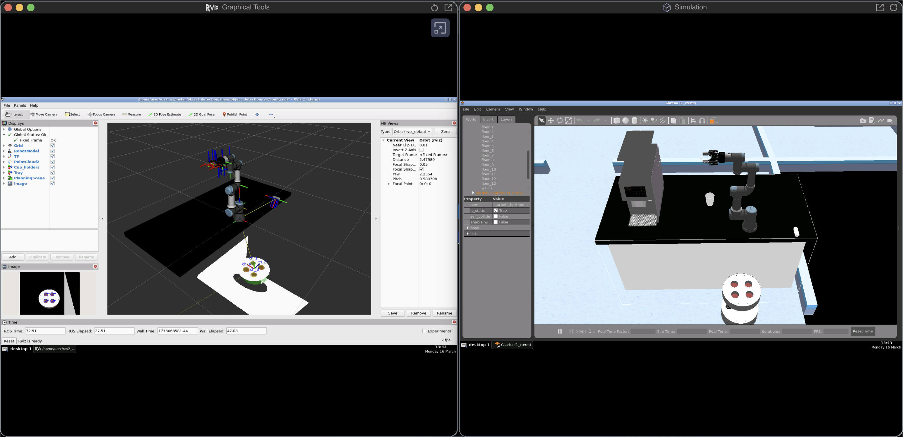
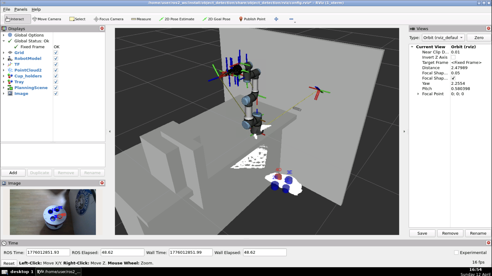

# Starbots Coffee Cup Dispenser - Simulation

**Robotics Developer Masterclass - Final Project**

A ROS 2 Humble project that uses a simulated UR3e robotic arm with a Robotiq 85 gripper in Gazebo to autonomously detect cup holders on a barista robot, pick up coffee cups, and deliver them to a specified holder. The system integrates computer vision, motion planning, and a behavior tree-based task executor, running entirely in the Starbots cafeteria simulation environment.



## Table of Contents

- [System Architecture](#system-architecture)
- [Packages Overview](#packages-overview)
  - [object\_detection](#object_detection---perception-pipeline)
  - [object\_manipulation](#object_manipulation---task-execution)
  - [my\_moveit\_config](#my_moveit_config---motion-planning)
  - [custom\_msgs](#custom_msgs---interface-definitions)
  - [universal\_robot\_ros2](#universal_robot_ros2---simulation-stack)
- [Perception System](#perception-system)
- [Manipulation System](#manipulation-system)
- [Web Interface (Foxglove)](#web-interface-foxglove)
- [Custom ROS 2 Interfaces](#custom-ros-2-interfaces)
- [Setup](#setup)
- [Usage](#usage)
- [Docker](#docker)
- [Troubleshooting](#troubleshooting)

## System Architecture

```
                        ┌──────────────────────┐
                        │   Wrist-Mounted      │
                        │   RGB-D Camera       │
                        │   (Gazebo Sensor)    │
                        └────┬─────┬─────┬─────┘
                             │     │     │
                           Color Depth PointCloud
                             │     │     │
                    ┌────────▼─────▼─────▼─────────┐
                    │   object_detection (Python)  │
                    │ ┌──────────────────────────┐ │
                    │ │ CupholderPerception      │ │
                    │ │ (contour + Hough circle) │ │
                    │ ├──────────────────────────┤ │
                    │ │ StableTracker            │ │
                    │ │ (EMA smoothing + NN)     │ │
                    │ └──────────────────────────┘ │
                    └─────────────┬────────────────┘
                                  │
                        /cup_holder_detected
                                  │
┌──────────────┐   ┌──────────────▼────────────────┐
│  Foxglove    │   │  object_manipulation (C++)    │
│  Web UI      │   │ ┌───────────────────────────┐ │
│  (optional)  │   │ │ BehaviorTree.CPP 4.6.2    │ │
│              │   │ │                           │ │
│ - 3D view    │   │ │ ValidateDetection         │ │
│ - Order btn  │◄──┤ │ PrePick ─► Pick           │ │
│ - Camera     │   │ │ PrePlace ─► Place         │ │
│ - Status     │   │ │ PutBack (recovery)        │ │
│ - Logs       │   │ │ Return (home)             │ │
└──────────────┘   │ └────────────┬──────────────┘ │
                   └──────────────┼────────────────┘
                                  │
                      ┌───────────▼────────────┐
                      │  MoveIt 2 Move Group   │
                      │ (OMPL + PILZ planners) │
                      └────────────┬───────────┘
                                   │
                      ┌────────────▼───────────┐
                      │  UR3e Gazebo Sim       │
                      │  (Starbots Cafeteria)  │
                      └────────────────────────┘
```



## Packages Overview

```
starbots_coffee_dispenser/
├── object_detection/        # Perception pipeline (Python)
├── object_manipulation/     # Task execution with BehaviorTree (C++)
├── my_moveit_config/        # MoveIt 2 config for UR3e + Robotiq 85
├── custom_msgs/             # ROS 2 message, service, and action definitions
├── universal_robot_ros2/    # UR3e simulation stack, Gazebo worlds, gripper models
├── docker/                  # Dockerfiles and docker-compose for containerized deployment
├── spawn_cup.sh             # Spawns a coffee cup in the Gazebo simulation
└── media/                   # Screenshots for documentation
```

### `object_detection` - Perception Pipeline

An `ament_python` package that processes RGB-D camera data from the wrist-mounted Gazebo sensor to detect and track cup holders on the barista robot's tray.

**Nodes:**

| Node | Description |
|------|-------------|
| `object_detection` | Main perception node: detects cup holders, publishes 3D positions |

**Key modules:**

- `perception_core.py` - Cup holder detection using contour analysis with Hough Circle fallback
- `tracker.py` - Multi-object tracker with EMA smoothing and nearest-neighbor matching
- `geometry.py` - 3D point projection from depth images to robot-frame coordinates
- `object_detection.py` - Main ROS 2 node wiring perception, tracking, and TF transforms

### `object_manipulation` - Task Execution

A `CMake` C++ package that orchestrates the full pick-and-place pipeline using BehaviorTree.CPP 4.6.2 and MoveIt 2.

**Executables:**

| Executable | Description |
|------------|-------------|
| `object_manipulation` | BehaviorTree executor + MoveIt 2 motion interface |
| `deliver_cup_bridge` | Wraps the `/deliver_cup` action as a ROS 2 service for Foxglove integration |
| `add_cafeteria_scene` | Adds collision objects (tray, platform) to the MoveIt planning scene |

**BehaviorTree nodes** (8 total):

| Node | Type | Role |
|------|------|------|
| `GoalNotCanceled` | Condition | Checks if the delivery goal is still active |
| `ValidateDetection` | Action | Confirms the target cup holder has a valid detection |
| `PrePick` | Action | Moves to a pre-grasp pose above the cup |
| `Pick` | Action | Closes the gripper to grasp the cup |
| `PrePlace` | Action | Moves to a pre-place pose above the target holder |
| `Place` | Action | Opens the gripper to release the cup |
| `PutBack` | Action | Recovery: returns the cup to its original position |
| `Return` | Action | Returns the arm to the home configuration |

### `my_moveit_config` - Motion Planning

Generated with MoveIt Setup Assistant and customized for the UR3e + Robotiq 85 simulation setup.

**Planning groups:**

| Group | Description |
|-------|-------------|
| `ur_manipulator` | 6-DOF arm chain: `base_link` to `tool0` |
| `gripper` | Robotiq 85 parallel gripper |

**Named poses:** `home`, `flex`, `open`, `close`

**Planners:** OMPL (default: BiTRRT, sampling-based) and PILZ (deterministic industrial fallback)

**Trajectory resolution:** `longest_valid_segment_fraction: 0.005`, `maximum_waypoint_distance: 0.001`

### `custom_msgs` - Interface Definitions

Defines all project-specific ROS 2 interfaces used for inter-node communication.

### `universal_robot_ros2` - Simulation Stack

A collection of packages that provide the complete Gazebo simulation environment for the project.

**Key sub-packages:**

| Sub-package | Description |
|-------------|-------------|
| `Universal_Robots_ROS2_Description` | URDF/Xacro models for UR robot arms |
| `Universal_Robots_ROS2_Gazebo_Simulation` | Gazebo simulation plugins and configurations |
| `gazebo_ros2_control` | Bridge between Gazebo physics and ROS 2 control manager |
| `barista_ros2` | Barista robot description, delivery utilities, and table detection |
| `robotiq_85_gripper` | Robotiq 85 gripper model and simulation plugins |
| `the_construct_office_gazebo` | Complete Starbots cafeteria Gazebo world |

## Perception System

The perception pipeline runs as a single ROS 2 node that subscribes to the wrist-mounted RGB-D Gazebo sensor and publishes stable, filtered cup holder detections in the robot's `base_link` frame.

### Detection Algorithm

1. **Preprocessing** - CLAHE contrast enhancement + adaptive thresholding + morphological open/close
2. **Circle detection** - Primary: contour-based (circularity threshold 0.58). Fallback: Hough Circle transform
3. **3D projection** - Detected circles are projected to 3D using depth data and camera intrinsics
4. **Frame transform** - Positions are transformed from camera optical frame to `base_link` via TF2

### Multi-Object Tracking

Each detection is tracked across frames by a `StableTracker`:

- **Association:** Greedy nearest-neighbor matching (6cm threshold)
- **Smoothing:** Exponential Moving Average on position (alpha 0.30)
- **Confirmation:** A track must persist for 4 consecutive frames before it is published
- **Garbage collection:** Tracks with missed frames are removed after hold timeout (0.80s)

### Published Topics

| Topic | Type | Description |
|-------|------|-------------|
| `/cup_holder_detected` | `custom_msgs/DetectedObjects` | Confirmed cup holder positions (3D, in `base_link`) |
| `/cup_holder_markers` | `visualization_msgs/MarkerArray` | RViz/Foxglove visualization markers |
| `/barista_cam_annotated` | `sensor_msgs/Image` | Annotated RGB image with detection overlays |

## Manipulation System

The manipulation node uses a BehaviorTree to sequence the pick-and-place pipeline. The tree is defined in `deliver_cup_tree.xml` and executed by BehaviorTree.CPP 4.6.2.

### Behavior Tree Structure

```
DeliverCupRoot (ReactiveSequence)
├── GoalNotCanceled                    ← checked on every tick
└── MainSequence
    ├── CoffeeDelivery
    │   ├── ValidateDetection
    │   ├── PrePick
    │   ├── Pick
    │   └── PlaceOrRecover (Fallback)
    │       ├── TrytoPlace
    │       │   ├── PrePlace
    │       │   └── Place
    │       ├── Inverter → PutBack     ← recovery: return cup
    │       └── Return                 ← last resort: go home
    └── Return
```

The `ReactiveSequence` at the root ensures the tree halts immediately if the goal is canceled. The `Fallback` node in `PlaceOrRecover` provides graceful degradation: if placing the cup fails, it attempts to put it back; if that also fails, it returns the arm home.

### Action Server

The main command interface is the `/deliver_cup` action, which accepts a target `cupholder_id` and reports progress through feedback messages. A service bridge (`deliver_cup_bridge`) also exposes the same functionality as a synchronous `/deliver_cup` service for use from the Foxglove web interface.

## Web Interface (Foxglove)

The project can use [Foxglove Studio](https://foxglove.dev/) for monitoring. The Docker Compose configuration starts **Foxglove Bridge** on port **8765** (rather than rosbridge on port 9090); check its logs if connection fails. Connect to `ws://localhost:8765` on the same machine or `ws://<SERVER_IP>:8765` from another machine.

Coffee delivery is exposed through the `/deliver_cup` **ROS 2 action**, which can be invoked from a terminal. The older, unfinished service bridge is not built.

**Available panels:**

| Panel | Description |
|-------|-------------|
| **3D Visualization** | Robot model, cup holder markers, TF frames |
| **Order Coffee** | Direct ROS 2 action via CLI; a Foxglove service button would need an additional service bridge |
| **Robot Status** | Live feedback from `/robot_status_feedback` |
| **Barista Tray Detections** | Annotated camera stream from `/barista_cam_annotated` |
| **ROS Logs** | Filtered `/rosout` log viewer |

## Custom ROS 2 Interfaces

### Action: `DeliverCup`

Main command interface for triggering a cup delivery.

```
# Goal
uint32 cupholder_id          # Target cup holder (1-4)
---
# Result
bool success                 # True if cup delivered successfully
string message               # Status or error description
---
# Feedback
string stage                 # Current execution phase
float32 progress             # 0.0 to 1.0
uint32 cupholder_id          # Active target holder
```

### Message: `DetectedObjects`

Per-holder detection output from the perception node.

```
uint32 object_id                  # Unique tracked ID
geometry_msgs/Point position      # 3D position in base_link frame
float32 height                    # Holder dimension
float32 width                     # Holder dimension
float32 thickness                 # Rim thickness
```

### Message: `DetectedSurfaces`

Detected plane/surface (tray).

```
uint32 surface_id
geometry_msgs/Point position
float32 height
float32 width
```

### Service: `PickPlaceCup`

Synchronous wrapper used by the Foxglove service call panel.

```
# Request
uint8 goal_cup_holder
---
# Response
string result
```

## Setup

### Prerequisites

- Ubuntu 22.04 LTS
- ROS 2 Humble
- Python 3.10+
- Gazebo (Classic)

### 1. Install system dependencies

```bash
source /opt/ros/humble/setup.bash
sudo apt update
sudo apt install -y git cmake build-essential libzmq3-dev libsqlite3-dev python3-pcl
```

### 2. Build BehaviorTree.CPP 4.6.2

The manipulation package depends on BehaviorTree.CPP 4.6.2, which must be built from source:

```bash
git clone https://github.com/BehaviorTree/BehaviorTree.CPP.git
cd BehaviorTree.CPP
git checkout 4.6.2

cmake -S . -B build \
  -DCMAKE_BUILD_TYPE=Release \
  -DBTCPP_BUILD_TOOLS=ON \
  -DCMAKE_INSTALL_PREFIX=$HOME/.local

cmake --build build -j"$(nproc)"
cmake --install build
```

Verify:

```bash
find $HOME/.local -name 'behaviortree_cppConfig.cmake'
```

### 3. Initialize rosdep (first time only)

```bash
sudo rosdep init
rosdep update
```

### 4. Build the workspace

Clone this repository into your ROS 2 workspace `src/` directory, then:

```bash
cd ~/ros2_ws
source /opt/ros/humble/setup.bash
source ~/.local/share/behaviortree_cpp/local_setup.bash

colcon build --symlink-install \
  --cmake-args -Dbehaviortree_cpp_DIR=$HOME/.local/share/behaviortree_cpp/cmake

source install/setup.bash
```

## Usage

### 1. Launch the Gazebo simulation

```bash
source ~/ros2_ws/install/setup.bash
ros2 launch the_construct_office_gazebo starbots_ur3e.launch.xml
```

> **Note:** The first launch may fail. Stop and relaunch — the second attempt should work.

### 2. Verify robot controllers

Confirm that the robot controllers are active:

```bash
ros2 control list_controllers
```

Expected:

```
joint_trajectory_controller[joint_trajectory_controller/JointTrajectoryController] active
joint_state_broadcaster[joint_state_broadcaster/JointStateBroadcaster] active
gripper_controller  [position_controllers/GripperActionController] active
```

Confirm joint states are streaming:

```bash
ros2 topic echo /joint_states --once
```

### 3. Verify camera topics

```bash
ros2 topic list | grep -E "depth|camera|point"
```

### 4. Launch the manipulation pipeline

```bash
source ~/ros2_ws/install/setup.bash
ros2 launch object_manipulation deliver_cup.launch.py
```

This single launch file starts all required nodes:

- Object detection (perception)
- MoveIt Move Group
- Collision scene setup
- RViz visualization
- BehaviorTree manipulation node (delayed start)
- Deliver cup service bridge

### 5. Send a delivery command

In another terminal:

```bash
source ~/ros2_ws/install/setup.bash
ros2 action send_goal /deliver_cup custom_msgs/action/DeliverCup "{cupholder_id: 1}" --feedback
```

Or use the Foxglove web interface to press **Order Coffee** with the desired holder ID.

## Docker

The project uses the original **two-container Docker Compose architecture**:

| Container | What it runs |
|-----------|-------------|
| `starbots-ros2-gazebo` | Gazebo Classic, the UR3e and its controllers, and the barista robot |
| `starbots-ros2-manipulation` | MoveIt 2, RViz, object detection, the BehaviorTree action server, and Foxglove Bridge |

The Gazebo container uses `docker/start-staged.sh` to spawn the world, UR3e and barista in stages and verify that all three UR3e controllers are active. The manipulation container uses the **original** Compose startup command: it waits 22 seconds before starting `deliver_cup.launch.py`, and starts Foxglove Bridge after another delay. These delays are not a Gazebo-readiness check; on slower machines, manipulation may start too early.

### Linux NVIDIA / X11 GUI setup (local override)

Gazebo and RViz need access to the host's X11 display. The following is the **locally tested** NVIDIA/X11 setup; it is host-specific and should not be committed with machine-specific values.

Create `docker/.env` with the correct values for your machine. For example (the paths and display number may differ):

```dotenv
DISPLAY=:1
XAUTHORITY=/run/user/1000/gdm/Xauthority
HOST_HOSTNAME=mainframe
```

Create `docker/gui.local.yaml`:

```yaml
services:
  starbots-gazebo:
    hostname: ${HOST_HOSTNAME}
    gpus: all
    privileged: false
    restart: "no"
    environment:
      XAUTHORITY: /tmp/host.Xauthority
      NVIDIA_VISIBLE_DEVICES: all
      NVIDIA_DRIVER_CAPABILITIES: compute,utility,graphics,display
      __GLX_VENDOR_LIBRARY_NAME: nvidia
    volumes:
      - "${XAUTHORITY}:/tmp/host.Xauthority:ro"

  starbots-manipulation:
    gpus: all
    environment:
      XAUTHORITY: /tmp/host.Xauthority
      NVIDIA_VISIBLE_DEVICES: all
      NVIDIA_DRIVER_CAPABILITIES: compute,utility,graphics,display
      __GLX_VENDOR_LIBRARY_NAME: nvidia
    volumes:
      - "${XAUTHORITY}:/tmp/host.Xauthority:ro"
```

Check that the `XAUTHORITY` file exists and is readable. Both `.env` and `gui.local.yaml` contain local configuration; keep them out of commits.

### Build the images

From the repository root:

```bash
cd docker
sudo docker compose -f docker-compose.yaml -f gui.local.yaml build
```

Only rebuild when dependencies or application source files change.

### Start both containers (original Compose method)

```bash
cd docker
sudo docker compose -f docker-compose.yaml -f gui.local.yaml config --quiet
sudo docker compose -f docker-compose.yaml -f gui.local.yaml up --no-build
```

This starts **both services**. Once built, there is no need to launch Gazebo or the manipulation ROS nodes manually in separate terminals. Wait until Gazebo prints `STARBOTS SIMULATION READY` and the manipulation logs show that the `/deliver_cup` action server is initialized before requesting a delivery.

The Compose `version` deprecation warning is harmless. To run in the background, use `up -d --no-build`; inspect logs with `sudo docker compose -f docker-compose.yaml -f gui.local.yaml logs -f`.

### Spawn a coffee cup

Before testing the physical grasp, ensure there is a coffee cup in the simulation. The repository provides a cup-spawning script:

```bash
sudo docker exec starbots-ros2-gazebo bash /home/user/ros2_ws/src/spawn_cup.sh
```

Do not spawn repeated cups at the same location without resetting the simulation.

### Request delivery to cup holder 1

In another terminal, while both containers are running:

```bash
sudo docker exec starbots-ros2-manipulation bash -lc '
  source /opt/ros/humble/setup.bash
  source /home/user/ros2_ws/install/setup.bash

  ros2 action send_goal \
    /deliver_cup \
    custom_msgs/action/DeliverCup \
    "{cupholder_id: 1}" \
    --feedback
'
```

This calls the existing ROS 2 **action** server, not a service. The optional `deliver_cup_bridge` service executable is currently excluded because its source file is absent; the direct action is functional.

### Stop, reset and repeat a test

To restore the initial Gazebo state and restart both containers without rebuilding:

```bash
cd docker
sudo docker compose -f docker-compose.yaml -f gui.local.yaml down
sudo docker compose -f docker-compose.yaml -f gui.local.yaml up --no-build
```

After startup, spawn the cup if needed and send the action again. Restarting is recommended when a previous attempt left the arm or cup displaced.

### Foxglove connection

The existing manipulation Compose command launches Foxglove Bridge on port **8765**, exposed to the host:

- Same machine: `ws://localhost:8765`
- Remote machine: `ws://<SERVER_IP>:8765`

RViz and Gazebo also open through X11 when the local override is configured correctly. The Foxglove connection itself should be verified separately.

### Known limitations (integration test, November 2026)

- Both Docker images build, Gazebo and RViz start, and the `/deliver_cup` action is accepted with live feedback.
- MoveIt 2 recognizes the arm and gripper controllers, and the simulated robot performs the delivery movement sequence.
- The robot did **not** physically grasp the cup during the observed test. A successful gripper command does not prove a physical grasp.
- The observed action ended with `success: false`, `Failed final return to home pose` (status `ABORTED`). The exact planning or execution root cause has not yet been established.
- The original fixed startup delays are preserved. If manipulation starts before Gazebo is ready, retry a clean startup or inspect the manipulation logs; no new orchestration mechanism is included here.

## Troubleshooting

| Problem | What to check |
|---------|---------------|
| `sleep: missing operand` and the manipulation container restarts | Ensure the manipulation `command:` is a YAML list containing one complete shell-command string, as in `docker/docker-compose.yaml`. |
| RViz cannot connect to display | Check `DISPLAY`, `XAUTHORITY`, the Xauthority file mount, and NVIDIA graphics support in `gui.local.yaml`. |
| `/deliver_cup` action unavailable | Check manipulation logs and wait until the action server initializes; confirm both containers can discover ROS 2 nodes. |
| No camera topics or detections | Confirm Gazebo has spawned the UR3e and barista and that the camera topics publish data. |
| Cup not physically picked up | Confirm the cup exists in Gazebo; investigate grasp geometry and physics separately from action feedback. |
| Final return-home motion fails | Inspect MoveIt logs to distinguish a planning failure from a trajectory-execution failure; the cause has not been verified. |
| Manipulation starts before Gazebo is ready | The original Compose startup uses fixed delays, not a full readiness check. |
